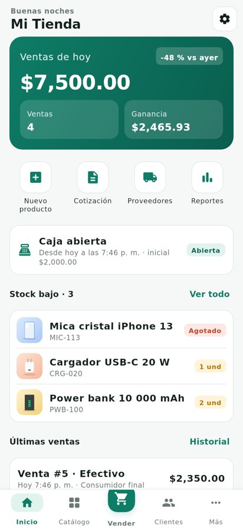
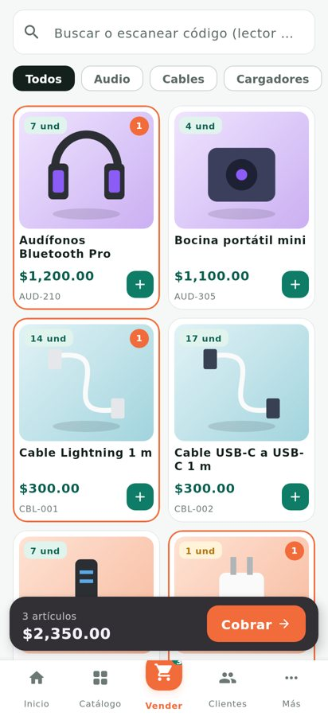
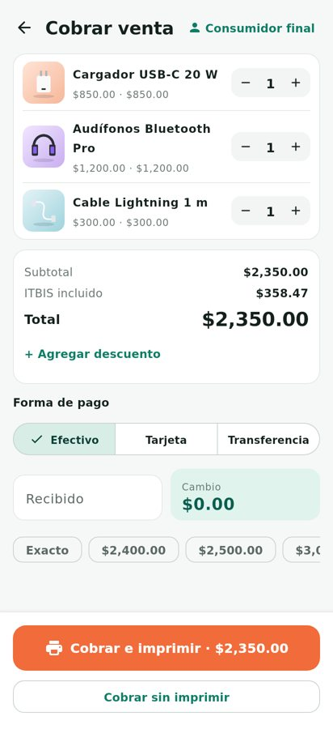
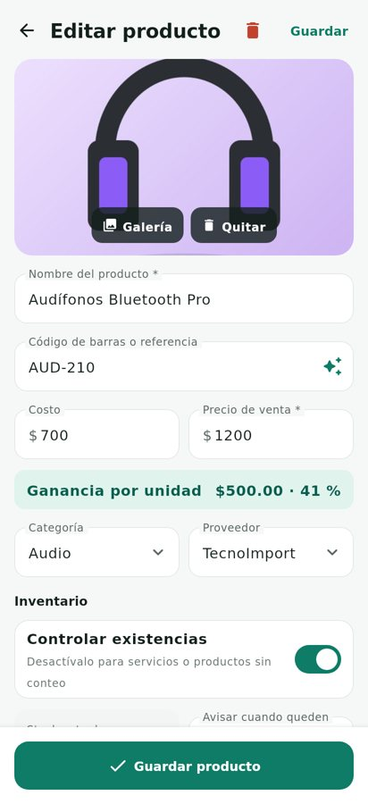

# Vitrina POS

Punto de venta con catálogo por fotos para **Android**, que también se puede instalar en **Windows**. Está hecho en Kotlin con Compose Multiplatform: el mismo código sirve para las dos plataformas.

Todo se guarda en el propio equipo, en un archivo local. No usa servidor, no necesita internet y no tiene cuentas en la nube.

<p>
  
  
  
  
</p>

## Qué incluye

| Módulo | Qué hace |
|---|---|
| **Inicio** | Ventas y ganancia del día, comparación con ayer, estado de la caja, accesos rápidos, productos con stock bajo y últimas ventas. |
| **Vender (POS)** | Cuadrícula de fotos con precio y stock. Se toca un producto para agregarlo. Búsqueda por nombre o código, filtros por categoría y escáner de códigos con la cámara (en Windows, lector USB). |
| **Cobro** | Cantidades, precio por línea, descuento por monto o %, cliente, efectivo, tarjeta o transferencia, cambio automático y botones de monto rápido. |
| **Catálogo e inventario** | Lista o cuadrícula, filtros de stock bajo, agotados y sin foto, valor del inventario, categorías con color, entradas de mercancía, ajustes de stock y movimientos. |
| **Producto** | Foto con la cámara o la galería (comprimida a unos 150 KB), código de barras escaneado o generado, costo, precio, ganancia calculada, stock mínimo, unidad e impuesto. |
| **Clientes** | Ficha, historial de compras y cotizaciones de cada cliente, y botones para venderle o cotizarle. |
| **Proveedores** | Contacto, productos que surte y entrada de mercancía, que suma stock y actualiza el costo. |
| **Cotizaciones** | Numeración COT-0001, estados, PDF A4 con logo y fotos ([ejemplo](docs/capturas/cotizacion-A4.pdf)). Se comparte por WhatsApp o correo y se convierte en venta con un toque. |
| **Ventas** | Historial por día, detalle con vista previa del ticket, reimpresión, compartir como texto y anulación (devuelve el stock). |
| **Reportes** | Vendido, ganancia, ticket promedio, ventas por día, por forma de pago, más vendidos y valor del inventario. |
| **Caja** | Apertura con monto inicial y cierre con efectivo contado: muestra si cuadra, sobra o falta. |
| **Configuración** | Datos del negocio y logo, moneda, impuesto (incluido o sumado), impresora, cotizaciones, trabajo en red, usuarios y respaldo. |

### Trabajo en red (varios equipos)

Varios celulares, tablets y computadoras trabajan con los mismos datos por Wi-Fi o cable de red, sin internet.

- Un equipo es el **principal** (lo ideal es la PC de la caja): guarda la base de datos, las fotos y los respaldos.
- Los demás se **conectan** escaneando el QR del principal o escribiendo su código de 6 números. La app busca sola los principales de la red.
- Lo que se hace en un equipo aparece en los demás en uno o dos segundos.
- Si un equipo conectado pierde la red, **sigue vendiendo**: las ventas quedan como pendientes (P1, P2…) y se envían solas al volver la conexión. El principal les asigna el número final.
- Desde el principal se ve qué equipos están conectados y se les puede quitar el acceso.
- Todo lo que viaja por la red va cifrado (AES-256-GCM) con una llave propia de cada equipo.
- Cada equipo usa su propia impresora y su propia caja.
- En Windows, la primera vez aparece el aviso del Firewall: hay que elegir "Permitir acceso" en redes privadas. Usa el puerto TCP 8740 y UDP 8741.

### Usuarios con PIN

Cada persona entra con su nombre y PIN, y queda registrado quién vendió, quién anuló y quién ajustó stock.

| Rol | Puede |
|---|---|
| Administrador | Todo: configuración, usuarios, trabajo en red, anular ventas, reportes y ganancias. |
| Vendedor | Vender, cotizar, clientes y catálogo. No anula ventas, no borra registros ni ve ganancias. |
| Técnico | Como vendedor, y además las órdenes del taller (próxima fase). |

### Impresión de tickets

- Papel de **58 mm** (32 caracteres) u **80 mm** (48 caracteres). Se elige en Configuración.
- Comandos **ESC/POS**, compatibles con la mayoría de impresoras térmicas.
- **Android:** por Bluetooth. Primero hay que vincular la impresora en los ajustes de Bluetooth del teléfono.
- **Windows:** con cualquier impresora instalada en el sistema.
- Acentos y ñ con la tabla PC850. Si una impresora muestra símbolos raros, se activa "Imprimir sin acentos".
- Opcional: abrir la gaveta de dinero e imprimir automáticamente al cobrar.

### Respaldo

"Crear respaldo" genera un `.zip` con la base de datos y las fotos. Se puede guardar en el teléfono, en una USB o en Drive, y restaurarlo en otro teléfono o en la PC con Windows.

## Cómo compilar

Requisitos: JDK 17 o superior, y Android SDK para el APK.

```bash
cd vitrina-pos

# APK de Android (sale en composeApp/build/outputs/apk/release/)
./gradlew :composeApp:assembleRelease

# Abrir la versión de escritorio
./gradlew :composeApp:run

# Instalador de Windows (.msi); hay que ejecutarlo en Windows
./gradlew :composeApp:packageMsi

# Pruebas (dinero, impuestos, ventas, stock, PDF, respaldo y trabajo en red con dos equipos)
./gradlew :composeApp:desktopTest

# Capturas de pantalla con datos de ejemplo
./gradlew :composeApp:desktopTest -Dscreenshots=/ruta/carpeta
```

El flujo `.github/workflows/vitrina-pos.yml` compila el APK y el instalador de Windows en GitHub Actions y los deja como artefactos descargables.

> El APK de `release` está firmado con la clave de depuración para poder instalarlo y probarlo. Antes de distribuirlo hay que configurar una firma propia en `composeApp/build.gradle.kts`.

## Estructura

```
composeApp/src/
  commonMain/            Código compartido (Android y Windows)
    sqldelight/          Tablas y consultas de la base de datos local
    kotlin/.../data      Repositorio, dinero e impuestos, fechas, respaldo, datos de ejemplo
    kotlin/.../net       Trabajo en red: servidor del principal, cliente, cifrado y búsqueda de equipos
    kotlin/.../print     Ticket ESC/POS para 58 y 80 mm
    kotlin/.../pdf       Cotización A4
    kotlin/.../ui        Tema, componentes y pantallas
  androidMain/           Cámara, galería, escáner, Bluetooth, PDF y compartir en Android
  desktopMain/           Archivos, impresoras de Windows y PDF (PDFBox) en escritorio
  desktopTest/           Pruebas y generador de capturas
```

Todo el dinero se guarda en centavos (números enteros) para evitar errores de redondeo. Las fotos se guardan solo por nombre de archivo para que los respaldos funcionen en cualquier equipo.
